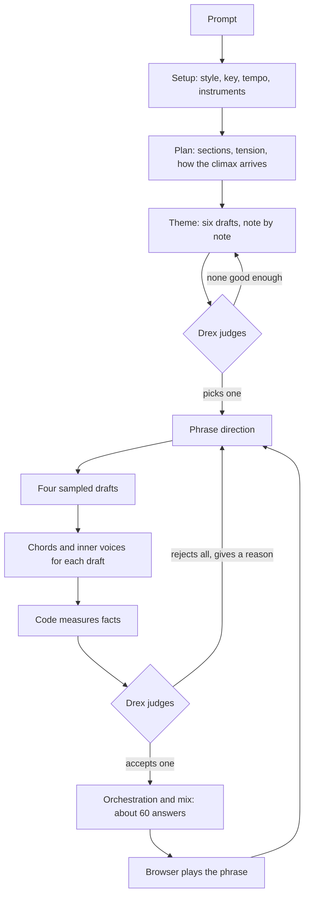

# Drex Composer

**Drex cannot create anything. It can only choose. So we turned composing into choosing, and Drex wrote the music.**

Type a prompt such as *"swimming alone at night"* and get about three minutes of original music.
Every musical decision in it, about 400 of them, was made by [Drex](https://console.nace.ai/docs/drex),
a model that cannot write a single note.

Built for the Nace Drexathon (Wildcard track) by EKo and Iniyan Kannappan.

## Contents

- [The problem](#the-problem)
- [The idea](#the-idea)
- [Listen](#listen)
- [How we used Drex, Intern and NDI](#how-we-used-drex-intern-and-ndi)
- [How it works](#how-it-works)
- [What Drex decides](#what-drex-decides)
- [The theory Drex is given](#the-theory-drex-is-given)
- [Run it locally](#run-it-locally)
- [Deploy it on Vercel](#deploy-it-on-vercel)
- [Intern, the producer](#intern-the-producer)
- [Evaluation](#evaluation)
- [Project layout](#project-layout)
- [Known limits](#known-limits)
- [Credits](#credits)

## The problem

Drex is a decision model. It has no way to produce a note, a word or a file. All it can do is answer a
question someone else wrote, in one of three forms:

| Question type | What Drex returns |
|---|---|
| Choice | A probability for each option |
| Yes or no | The probability of yes |
| Score | A probability for each level of a scale |

So how do you get something as open-ended as a piece of music out of a model that can only pick?

## The idea

Break composing into small questions and let Drex answer every one.

- **Drex decides.** Style, key, tempo, instruments, the plan of the piece, every note of the theme, every
  chord, every inner voice, which drafts are good enough, who plays and how loud.
- **Code does not decide.** It lays out the options, plays the notes, measures facts (how far a melody
  leaps, which instruments are resting, how similar two phrases are) and enforces what Drex chose.
- **Nothing is hidden.** The page shows each question, the options, Drex's probabilities and its pick,
  while the music plays.

Two kinds of music are supported: **orchestral** pieces (piano, strings, winds, percussion from real
samples) and **smooth beats** (lo-fi, boom-bap, trap, funk and house, on synths and a drum kit).

## Listen

Five pieces composed by live Drex are saved in [`replays/`](replays/) and play in the browser with every
decision visible. On a running copy of the app, open:

| Piece | Prompt | Address |
|---|---|---|
| Night swimming | "swimming alone at night" | `/?replay=night-swimming` |
| Night swimming, produced by Intern | "swimming alone at night" | `/?replay=night-swimming-by-intern` |
| Smooth beats | "smooth late-night beats to relax to" | `/?replay=smooth-beats` |
| Funk | "a funky upbeat groove for a summer block party" | `/?replay=funk` |
| Trap | "a late-night rap beat with heavy 808s" | `/?replay=trap` |

A saved piece has a seek bar: play, pause, skip, or click the tension plan to jump to a phrase.

## How we used Drex, Intern and NDI

| Tool | Role | Evidence in this repository |
|---|---|---|
| **Drex Max** (`drex-max-v1.1`) | Makes every musical decision: about 400 sets of questions per piece | [`server/calls/`](server/calls/) holds every question; [`replays/`](replays/) holds five full runs with each answer and its probabilities |
| **Intern** | The producer: commissions a piece, waits, measures it, writes a report. Drex is its System 1 and checks every turn | [`AGENTS.md`](AGENTS.md), [`INTERN.md`](INTERN.md), [`tools/intern.ts`](tools/intern.ts). A real run took 16 turns with 42 Drex checks |
| **NDI** | Parsed a 136-page theory book and extracted page-cited rules | [`tools/ndi/`](tools/ndi/), [`context-pack/digest.ndi.json`](context-pack/digest.ndi.json): 32 rules from three chapters of Goetschius |

**How Drex's answers are used.** Because Drex returns probabilities, there are two ways to pick:

- *Drafts* (theme notes, phrase direction, chords, voice leading) are **sampled** from the probabilities,
  so four drafts of a phrase differ.
- *Decisions* (rules, plan, judging, orchestration) take the **top pick**.

**The prompt steers it.** Measured on live Drex:

| Prompt | How Drex chose the climax to arrive |
|---|---|
| "swimming alone at night" | a still, bright clearing: 98% |
| "a storm breaking over a battlefield" | a wall of sound: 78% |
| "a late-night rap beat with heavy 808s" | song form "hook first": 100% |
| "lofi beats to study to" | song form "one groove, no chorus": 73% |

A full piece takes about a minute of Drex calls on the paid tier and costs roughly 20 cents.

## How it works



1. **Setup.** Drex answers about 40 questions that fix the rules of the piece.
2. **Plan.** Drex lays out the sections, a tension level for each, where the climax falls and how it arrives.
3. **Theme.** Six drafts are written one note at a time from Drex's answers. Drex judges them and may
   reject them all.
4. **Phrases.** For each phrase Drex chooses its length and material, four drafts are sampled, Drex picks
   every chord and voice, code measures facts about each draft, and Drex accepts one or rejects all with a
   reason that feeds the next round. There is no cap on redrafting.
5. **Orchestration.** For the accepted phrase Drex decides which layers play, on which instruments, how
   loud, how the phrase begins and closes, and every effect amount.
6. **Playback.** The browser plays each phrase with sampled instruments and a real concert-hall reverb
   while the next ones are composed.

One phrase takes 16 to 33 Drex calls depending on style.

## What Drex decides

| Stage | Decisions |
|---|---|
| **Setup** | Style sheet; groove family for beats (lo-fi, boom-bap, trap, funk, house); tempo; meter; key and mode; harmonic language; the palette (yes or no for each instrument); sound world; length (2:30 to 3:30); form; key-change plan; ending |
| **Plan** | Each section's role and tension (1 to 7); whether a section leaves the theme; where the climax falls; how it arrives; what the melody is at the climax; whether the theme is stated twice; whether a counter-theme and a contrast theme are needed. Tension is revised at every section end |
| **Song form** (beats) | One of four forms (verse and chorus; verse, pre-chorus, chorus; hook first; one groove) and one loudness level for each kind of part, so every chorus is a peak and every verse drops back |
| **Theme** | How many bars it fills (1 to 3); note count; contour; rhythm cell; start and end notes; where its one leap sits; then each note in turn |
| **Each phrase** | Length (2 to 6 bars; beats stay at 4); material and transformations for each half; counter-melody; seven texture choices; how fast the chords change; the ending; any modulation |
| **Harmony** | Every chord, every bass move, and how each inner voice moves at every chord change |
| **Judging** | Which draft is played, or that none is; the reason for a rejection |
| **Orchestration** | How full the texture is; which layers play; the melody's instrument and register; a second instrument doubling it; how the melody begins (on the beat, with a pickup, a beat late); whether instruments change over cleanly or dovetailed; who drops out mid-phrase; how the phrase closes (run on, a breath, a silence); how loudness moves inside it; drum and bass patterns; accents; six effect amounts |

**How the climax can arrive** (Drex's choice in the plan):

| Arrival | What happens |
|---|---|
| Swell | No break; the peak arrives at the top of a crescendo |
| Hit | One accented blow on the same texture |
| Clearing | A held breath, then the motion stops and the music opens out, still and bright, only a little louder |
| Wall | A held breath, then the whole ensemble at full volume |
| Broadened wall | The wall, with the tempo slowing |
| Drop (beats) | The beat thins for a bar, then everything returns at full weight |

**Facts, never verdicts.** With each question code gives Drex measured facts, for example: how far a
melody option starts from where the last phrase ended, whether its top note beats the highest so far,
which instruments have played without a break, the lengths of the last few phrases, and what the fullest
chorus so far used.

## The theory Drex is given

Drex knows little music theory on its own, so the rules travel with each question.

| Source | Rules | Notes |
|---|---|---|
| Rimsky-Korsakov, *Principles of Orchestration* | 32 | Project Gutenberg ebook 33900 |
| Goetschius, *Exercises in Melody-Writing* (1900) | 37 | archive.org scan |
| Tchaikovsky, *Guide to the Practical Study of Harmony* | 32 | archive.org scan |
| Prout, *Musical Form* (1893) | 49 | archive.org scan |
| Our own | 31 | General knowledge the 1890s books do not cover, such as where a climax goes. Marked `own` |
| Rules for beats | 46 | Hand-written (grooves, hooks, bass, arrangement, song form). Sent only to beat pieces. Marked `own` |

- The 150 book rules each carry a page reference and a supporting quote
  ([`context-pack/digest.json`](context-pack/digest.json), `digest.evidence.json`). A checker confirms each
  quote is on the cited page: `node tools/ndi/check-digest.mjs`.
- Each kind of decision receives its own slice of the rules, between 8 and 40 of them.
- Three style sheets ([`context-pack/style-sheets.json`](context-pack/style-sheets.json)) describe the
  orchestral, beat and playful styles.
- The page's theory panel shows which rules each decision received and opens the book at the cited page.

**What NDI did.** The digest Drex composes from was curated by reading the books. Separately, NDI parsed
the Goetschius scan (136 pages), classified its first three chapters and extracted 32 page-cited rules
into [`context-pack/digest.ndi.json`](context-pack/digest.ndi.json). Those rules are not fed to Drex: they
are vaguer than the curated ones, and we use them to check the curated pack against the source. The
pipeline for all four books is in [`tools/ndi/ingest.mjs`](tools/ndi/ingest.mjs).

## Run it locally

Needs Node 24 or newer.

```bash
npm install
cp .env.example .env     # then set NACE_API_KEY=nace_sk_...
npm run dev              # server on :8787, page on http://localhost:5173
```

Open http://localhost:5173, type a prompt and press Enter.

**Without a key** the project still runs: an offline stand-in answers in place of Drex and the page shows
a `STAND-IN` badge. The stand-in is a set of hand-written guesses for building and testing. It is not Drex
and says nothing about Drex's taste.

**If Drex answers 403.** Nace documents two hosts for the same API. The app tries `console.nace.ai`, and
switches to `drex.nace.ai` if the first answers with a security-check page. To pin one, set `DREX_API_URL`.

| Command | What it does |
|---|---|
| `npm run dev` | Server and page, reloading on changes |
| `npm run compose -- "a prompt" [--json out.json] [--midi out.mid]` | Compose a whole piece without the browser and print every choice |
| `npm run audit -- <run>` | Measured facts about a saved run: sections, loudness, instruments, where the climax falls |
| `npm run intern -- "a prompt"` | Hand a commission to Intern (see below) |
| `npm run ping` | One tiny live Drex call, to check a key |
| `npm test` | 71 tests |
| `npm run typecheck` | Type check |
| `npm run eval` | The evaluation table below |
| `npm run build && npm start` | Production build served on :8787 |

**Saving and replaying a piece.**
`npm run compose -- "a prompt" --json eval/results/<name>/events.json` saves a run, and
`http://localhost:5173/?replay=<name>` plays it without calling Drex again.

Environment variables are listed in [`.env.example`](.env.example).

## Deploy it on Vercel

The app deploys as a static site plus two small functions.

| Part | How it runs on Vercel |
|---|---|
| Saved pieces | Static files from [`replays/`](replays/) |
| Theory panel and the four books | Static files written at build time |
| Composing a new piece | [`api/compose.js`](api/compose.js): one request composes one piece and streams each Drex decision to the page |
| Health check | [`api/health.js`](api/health.js): open `/api/health` to see whether the deployment has the key and can reach Drex (the key is never shown) |

1. Import the repository in Vercel. The settings come from [`vercel.json`](vercel.json).
2. Add the environment variables `NACE_API_KEY`, `DREX_MODEL=drex-max-v1.1` and `DREX_TIER=paid`.
3. Deploy. New variables only apply to new deployments, so redeploy after changing them.

- The functions are bundles of [`server/vercel.ts`](server/vercel.ts) and `server/vercel-health.ts`.
  After changing server code run `npm run build:api` and commit the result.
- Anyone who opens the site can compose, and each piece costs Drex credit.
- A function cannot hear the browser's playhead, so on Vercel a piece is composed straight through
  instead of a few phrases ahead of playback.

## Intern, the producer

[Intern](https://github.com/nace-ai/intern) is Nace's agent harness. Its System 2, any chat model, does
the work; its System 1, Drex, watches every turn.

```bash
uv tool install "intern-agent @ git+https://github.com/nace-ai/intern"
npm run dev                                   # in one terminal
npm run intern -- "swimming alone at night"   # in another
```

Following [`AGENTS.md`](AGENTS.md), Intern:

1. commissions the piece from the running server, passing the words on unchanged;
2. waits about a minute while Drex composes it;
3. measures it with `npm run audit`;
4. writes `eval/results/<id>/REPORT.md` with the link to listen and the measured facts.

Intern makes no musical choice and is told not to describe music it has not heard, so a piece it produces
is exactly what the app composes on its own. Setup details are in [`INTERN.md`](INTERN.md).

The commission API it uses is open to any agent:

```bash
curl -X POST http://localhost:8787/api/commissions \
  -H "Content-Type: application/json" -d '{"prompt": "swimming alone at night"}'
curl http://localhost:8787/api/commissions/<id>     # status, then listen_url, midi_url and a summary
```

## Evaluation

`npm run eval` runs the table below. The results shown are from the offline stand-in: they check the
engine and the facts it measures, and say nothing about Drex.

| Test | How it is run | Result on the stand-in |
|---|---|---|
| Drex follows theory | 200 hand-written cases, 20 per call type, in [`eval/cases/`](eval/cases/). Pass is 16 of 20 | Not run against live Drex |
| Not random | Writes a Drex piece and a random-picker piece for blind listening | Needs ears |
| Theme survives | Writes the theme and a late phrase for listening | Needs ears |
| No repetition | Similarity across all phrase pairs of three pieces | Pass: 521 pairs, closest 71% |
| Judge works | Two planted copies and an off-theme draft must be rejected | Pass |
| Prompt matters | Two opposite prompts | Pass: 8 of 8 rules differ |
| Style choice | Nine prompts, three aimed at each style | Pass: 9 of 9 |

**How changes were checked.** Each change to the composer was checked by composing a piece on live Drex
and measuring its note data: leaps where phrases join, silence, instruments per phrase, loudness per
section, where the highest note falls. `npm run audit` prints those measurements for any saved run.

## Project layout

| Part | Where | What it holds |
|---|---|---|
| Questions | [`server/calls/`](server/calls/) | Every question Drex is asked, and the code that turns answers into notes |
| Composer core | [`server/core/`](server/core/), [`server/piece.ts`](server/piece.ts) | Scales and chords, 20 melodic transformations, the fact measurer, the text sent with each question |
| Drex client | [`server/gateway/`](server/gateway/) | Key, queue, rate limits, retries, host fallback, the stand-in |
| Theory pack | [`context-pack/`](context-pack/), [`server/pack.ts`](server/pack.ts) | Rules, style sheets, worked examples, the four books |
| Server | [`server/index.ts`](server/index.ts), [`server/session.ts`](server/session.ts) | Live sessions over a socket, replays, the commission API |
| Audio | [`web/src/audio/`](web/src/audio/) | Sampled instruments, ten synths, hall reverb, scheduling, seeking |
| Page | [`web/src/panel/`](web/src/panel/) | Rules, tension plan, current question and probabilities, drafts and verdicts, lineage, layers, theory panel, seek bar |
| NDI | [`tools/ndi/`](tools/ndi/) | Book pipeline and the pack checker |
| Agent tools | [`tools/intern.ts`](tools/intern.ts), [`tools/audit.ts`](tools/audit.ts) | Intern as producer; measured facts |
| Vercel | [`api/`](api/), [`vercel.json`](vercel.json), [`replays/`](replays/) | Functions, settings, saved pieces |

## Known limits

- **Drex cannot hear.** It judges notation and measured facts.
- **Drex only picks from options it is given.** Its range is the option lists and the transformation library.
- **Checked by measurement, not by ear.** Most of the composer was tuned against note data from live
  pieces. Balance, realism and taste still need a listener.
- **The six newest synth sounds** (electric piano, lead, supersaw, synth bass, bell, brass) have volumes
  set by estimate.
- **Runs are not repeatable.** The same prompt gives a different piece each time: drafts are composed in
  parallel and draw from one random stream in arrival order.
- **Pop was dropped.** Chart pop needs vocals and production this engine does not have, so the beat style
  covers smooth and groove-based beats only.
- **The beat rules are hand-written**, not drawn from a book.
- **NDI has run on one book**, three chapters. The curated digest, not the NDI output, is what Drex reads.
- **Intern has been run once** end to end, with Claude Haiku 5.5 as its System 2.
- **The Vercel functions were tested on a development machine**, not verified on a live deployment by us.
- **The backdrops are placeholders** drawn by a script.
- **No celesta**, and the double basses are a solo contrabass: the free sample libraries have neither.

## Credits

**Piano.** Salamander Grand Piano V3 by Alexander Holm, licensed CC BY 3.0, obtained through the
sample set hosted for @tonejs/piano. Five of its sixteen velocity layers are used; files were
trimmed, level-adjusted and re-encoded.

**Hall reverb.** Jack Lyons Concert Hall impulse response (listening position 2) by Alex Duffell,
Aishwarya Sridhar and Zhong Li, Audiolab, University of York, from OpenAIR (www.openairlib.net),
licensed CC BY 4.0. Decoded from B-format to stereo, trimmed and resampled. This is the hall the
Composer uses. A second OpenAIR recording, the Arthur Sykes Rymer Auditorium (University of York,
CC BY 4.0), is also in `assets/ir/`.

**Orchestra.** VSCO 2 Community Edition by Versilian Studios (Sam Gossner) and Ivy Audio (Simon
Dalzell), CC0. Glockenspiel and vibraphone from VCSL by Versilian Studios, CC0.

**Drum kit.** Salamander Drumkit by Alexander Holm, CC BY-SA 3.0. The converted drum files in
`assets/samples/drumkit/` are modified samples and stay under CC BY-SA 3.0 wherever they are served.

Full detail, including every modification, is in `assets/CREDITS.md`.
